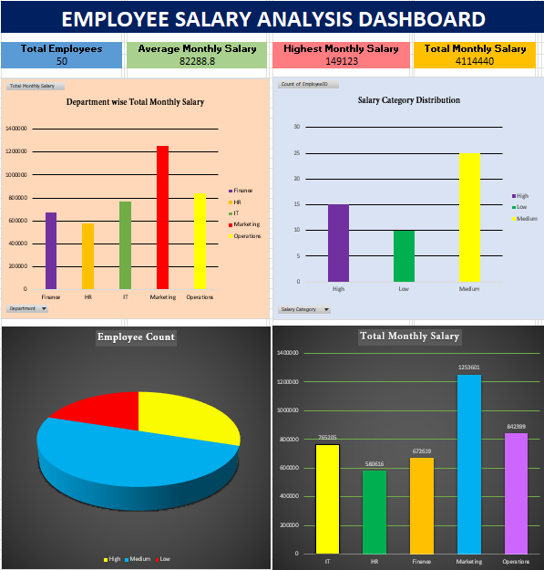

# employee-salary-analysis-excel
Employee Salary Analysis Dashboard using Microsoft Excel

# Employee Salary Analysis using Microsoft Excel

## About the Project

This project is based on employee salary data analysis using Microsoft Excel. It focuses on understanding salary distribution, comparing departments, and presenting useful information through charts and a dashboard.

## Project Objectives

The main objectives of this project are to analyze employee salary data, compare monthly salary expenses across departments, and understand employee distribution across different salary categories.

## Skills and Tools Used

Microsoft Excel
Data Analysis
Pivot Tables
Data Visualization
Dashboard Creation

## Dashboard Preview

The dashboard presents the key findings of the employee salary analysis in a simple visual format.

## Project Files

The Excel workbook includes the original dataset, Pivot Tables, and the completed dashboard.

## Learning Outcomes

This project helped me gain practical experience in analyzing data, creating Pivot Tables, comparing information across departments, and presenting insights through charts and dashboards.

